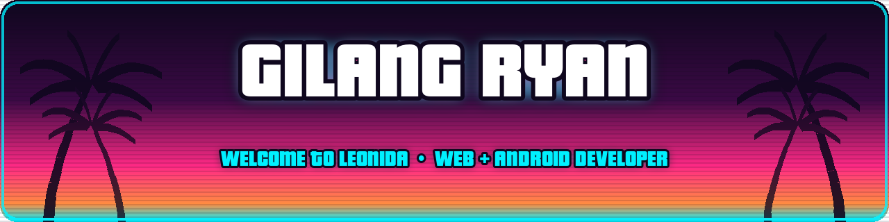

<!-- GTA VI / VICE CITY HEADER -->

  

 

---

  
   
  

<table>
  <tr>
    <td width="50%" valign="top">
      <h3>🪪 Character Info</h3>
      <ul>
        <li>👤 <b>Name:</b> Gilang Ryan Eka Putra</li>
        <li>🎓 <b>Class:</b> Bachelor of Informatics Graduate</li>
        <li>💻 <b>Main Role:</b> Web & Android Developer</li>
        <li>🚀 <b>Passive Skill:</b> Building modern & user-friendly apps</li>
        <li>📚 <b>Status:</b> Always learning & exploring new tech</li>
      </ul>
    </td>
    <td width="50%" valign="top">
      <h3>🎯 Active Missions & Interests</h3>
      <ul>
        <li>🌐 <b>Web Development</b> — Modern frontend & backend systems</li>
        <li>📱 <b>Android Development</b> — Native & cross-platform mobile apps</li>
        <li>🎨 <b>UI/UX Design</b> — Clean, intuitive user interfaces</li>
        <li>💡 <b>Software Development</b> — Practical digital solutions</li>
        <li>🔍 <b>Exploring New Tech</b> — Leveling up the stack</li>
      </ul>
    </td>
  </tr>
</table>

---

  

| Category | Arsenal |
| :--- | :--- |
| **💻 Languages** |        |
| **🌐 Web & Backend** |      |
| **🗄️ Cloud & Database** |        |
| **🎨 Design & Creative** |    |
| **🛠️ DevOps, IoT & Tools** |        |
| **🎮 Gaming & Engines** |       |

---

  

  
  

  

---

  

  

  

---

  

